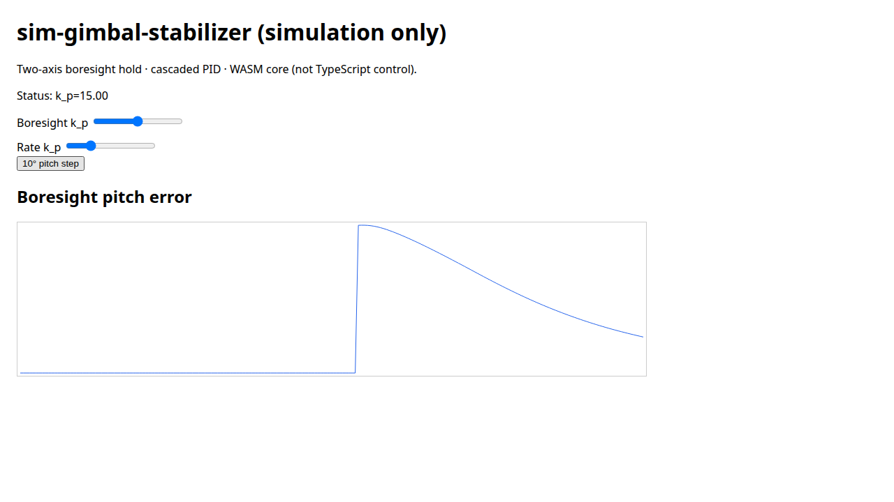

# sim-gimbal-stabilizer

**Portfolio demo — simulation only.** This repo is not production gimbal firmware, has never been flown or flight-tested, is not certified, and does not implement FOC/BLDC drive hardware. Author: **Arpan Bom**.



Two-axis camera gimbal shake rejection in software: an outer **boresight** loop and an inner **inertial-rate** loop (camera gyro), with a complementary filter or an optional 6-state error-state estimator (decoupled scalar measurement updates; yaw-bias convergence on the static bench is a stationary-gate blend — see `DEVIATIONS.md`). A discrete-time PID with back-calculation anti-windup drives a simplified per-joint torque plant (not FOC).

## What you are looking at

| Layer | Role |
| --- | --- |
| `sgs_core` | C++17, no heap, MCU-shaped controller + estimators |
| `sgs_sim` | Host/WASM plant, sensors, scenario runner |
| `web/` | TypeScript UI + Canvas 2D; **same** C++ via WASM |

Licensed under **Apache License 2.0** — see `LICENSE` and `NOTICE`.

## Locked default gains

| Loop | k_p | k_i | k_d |
| --- | ---: | ---: | ---: |
| Rate (inner) | 0.05 | 0.40 | 2e-4 |
| Boresight (outer) | 10 | 2.0 | 0.10 |

Shared: τ_d = 5 ms, τ_max = 0.15 N·m, inner torque dead-zone = 0.001 N·m, `|θ|` authority warning at 75° (yaw integrator freeze). EKF defaults include `ekf_sigma_mag = 1.0 µT`. **No v1 base-rate feed-forward.**

Optional Python: `cmake -DSGS_BUILD_PYTHON=ON`, then `PYTHONPATH=build/python python3 -m pytest -q python/tests`.

## Frames and conventions

- World **NED**, camera **FRD**, Hamilton quaternions, active rotations.
- Joint order: base yaw, then pitch. **Positive pitch moves the optical (+x) axis toward world −z (up in FRD).**
- Controlled objective: optical-axis / boresight hold. A 2-axis gimbal does not reject roll about the optical axis; residual roll is unactuated and is not hidden.
- At rest, a level camera IMU reports specific force `[0, 0, −g]` in FRD (`g_ned = [0, 0, +g]`).

## Build and test (core)

```bash
cmake -S . -B build -DCMAKE_CXX_COMPILER=g++-13 -DCMAKE_BUILD_TYPE=Release \
  -DSGS_BUILD_PYTHON=OFF -DSGS_BUILD_ROS=OFF -DSGS_BUILD_WASM=OFF
cmake --build build -j
ctest --test-dir build --output-on-failure
python3 tools/check_no_heap.py
```

Optional: `SGS_BUILD_PYTHON=ON`, `SGS_BUILD_ROS=ON`, `SGS_BUILD_WASM=ON` (see `scripts/build_wasm.sh` for emsdk **7.0.0**).

## Browser demo

```bash
bash scripts/build_wasm.sh
cd web && npm ci && npm run dev   # or npm run build && npm run preview
```

Pages URL base path: `/sim-gimbal-stabilizer/`.

## Plant and disturbances (teaching model)

Per joint: `J α = τ − b ω − τ_c tanh(ω/0.05) − k_spring q` with frozen `J,b,τ_c,k_spring` from `PLAN.md`. Semi-implicit Euler at 1 ms. Documented multi-tone vibration plus 1-cosine gusts — not Dryden turbulence.

## Estimator honesty

- Accelerometer gravity tilts the filter but **does not observe yaw**. Accel-only updates are blind in yaw; mag-off tests skip yaw correction.
- The complementary filter **does not estimate gyro bias** (biased-gyro equilibrium is expected).
- The optional estimator is not a full coupled 6×6 ESKF; see `DEVIATIONS.md`.
- Accel magnitude gate does not reject all translational motion.
- **10 Hz** pitch/yaw isolation is largely passive spring/inertia; the **0.5 Hz** closed vs open-loop pair is the feedback proof. The 10 Hz claim is pitch and yaw only.

## Idea credits (no vendored controller source)

See `REFERENCES.md` and `NOTICE`. Examples: PX4 (BSD-3-Clause), SimpleFOC (MIT, structure ideas only), Fusion / TinyEKF / ahrs (MIT), control_toolbox (Apache-2.0), Valenti complementary idea (paper DOI in REFERENCES), robot_localization (BSD-3-Clause).

## Author

Arpan Bom · applycoding@gmail.com
